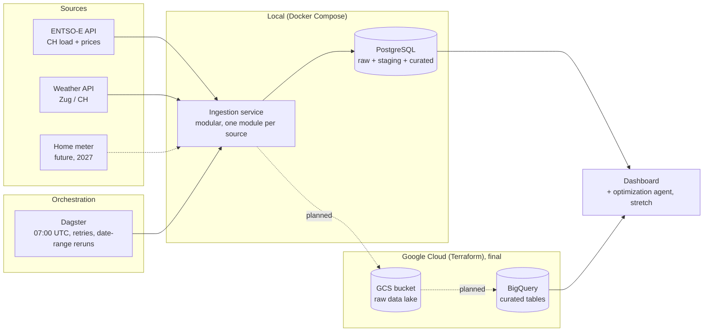

# Saftimize architecture v0.2

Status: local midterm implementation. Cloud components in the diagram are planned, not deployed.

A uv-managed Python package separates ENTSO-E and Open-Meteo source modules. Daily UTC request windows land unchanged in `raw.responses` in PostgreSQL. Request/body hashes preserve revisions and prevent identical duplicates. A three-day lookback catches recent corrections; explicit dates support historical reruns. Dagster runs ENTSO-E ingestion before the hourly transformation at 07:00 UTC daily. Compose provides PostgreSQL, a Dagster code server, webserver, daemon, one-time instance initialization, and a manual pipeline command, all on its default network. A shared named volume holds local Dagster SQLite metadata; PostgreSQL stores analytical data separately.

Compared with v0.1: Dagster is selected, the local runtime is containerized using uv, and the midterm model is a single hourly joined table instead of speculative fact/dimension tables. Open-Meteo ingestion is available but not part of the scheduled midterm job. The final model can evolve without claiming the cloud path already exists.

## Overview

## Layers

| Layer | Midterm (local) | Final (cloud) |
|---|---|---|
| Ingestion | Python modules, one per source, run by the orchestrator | Same modules, writing directly to GCS (no local staging in the production path) |
| Raw storage | Raw tables in PostgreSQL | GCS bucket, files partitioned by source and date |
| Transformation | Python interval normalization and weighted hourly join; raw to curated with in-memory staging | Reads from the lake, writes curated BigQuery tables |
| Serving | PostgreSQL curated tables | BigQuery, partitioned by date, clustered by series |
| Orchestration | Dagster code server, webserver and daemon in Docker Compose | Same, schedulable |
| Infrastructure | Docker Compose network | Terraform: GCS bucket, BigQuery dataset |

## Implemented midterm model

`curated.hourly_energy`: one row per UTC hour and Swiss bidding zone, containing duration-weighted load in MW, price in EUR/MWh, and separate coverage seconds. Incomplete means are null. Raw intervals are parsed in memory; no persisted staging layer is needed at this volume. Range replacement is transactional. UTC keys preserve distinct autumn DST hours; local timestamps are display-only. Prices are wholesale signals, not household bills. Hourly aggregation sacrifices sub-hour price detail in exchange for a consistent comparison grain.

## Planned final tables (not yet implemented)

- `fct_load_hourly`: one row per hour and area
- `fct_price_hourly`: one row per hour and area
- `fct_weather_hourly`: one row per hour and location
- `dim_time`: one row per hour
- a joined feature table for forecasting: one row per hour

## Key decisions (initial)

| Decision | Choice for now | Reason |
|---|---|---|
| Load strategy | Incremental by date window with lookback | Data is append-mostly but values get revised |
| Frequency | Daily | Day-ahead prices appear once per day |
| Failure behaviour | HTTP retries plus two Dagster step retries, then failed run visible in UI/logs; no external alerting yet | Safe reruns without silently accepting missing data |
| Orchestrator | Dagster with ingestion → transformation job | Python-native configuration, visible dependencies and run history, bounded retries; simple local deployment |
| Dashboard | Open (Looker Studio or custom web app) | Not graded directly, keep cheap |

## Division of responsibilities

Solo project, instructor confirmation recorded in the backlog. All components owned by one person.

## Risks

- Source API instability or token issues
- Time zone handling around daylight saving
- Scope creep from the optimization agent (kept as a stretch goal)
- Cloud cost and credentials (no secrets in the repo, `.env.example` only)